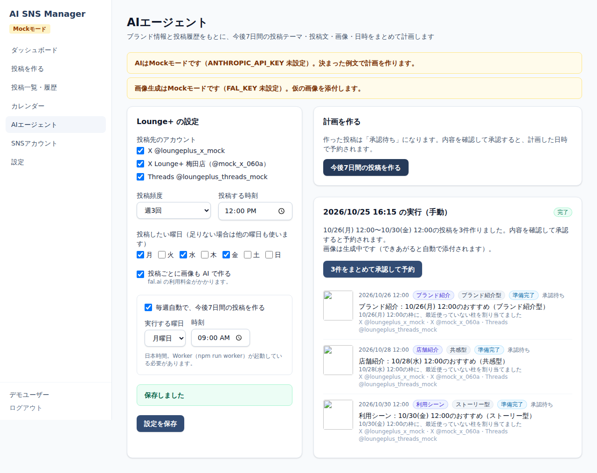
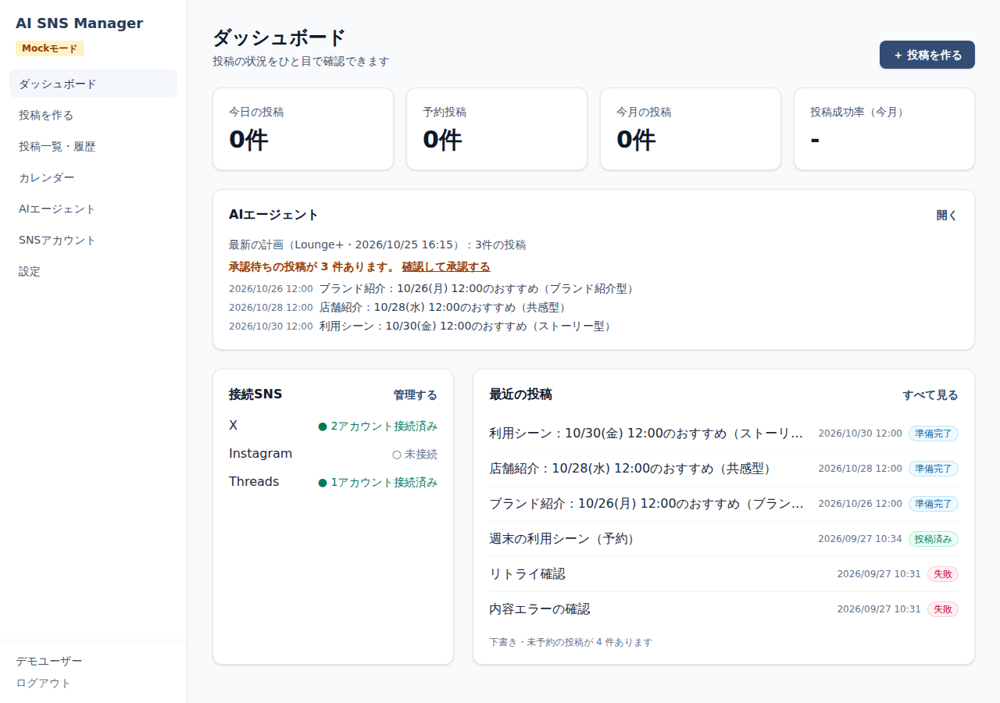
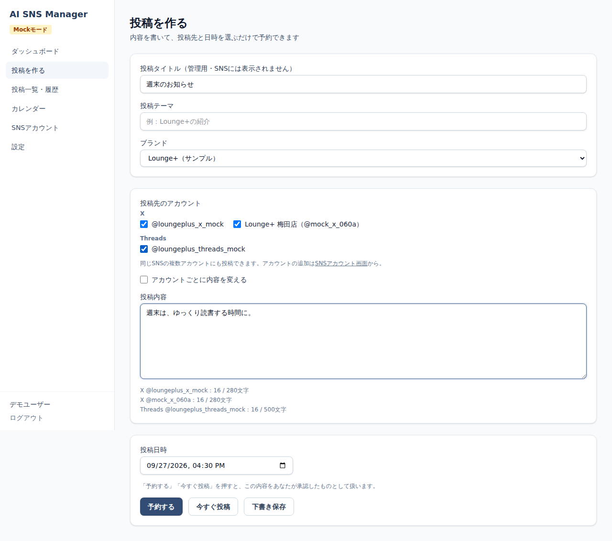
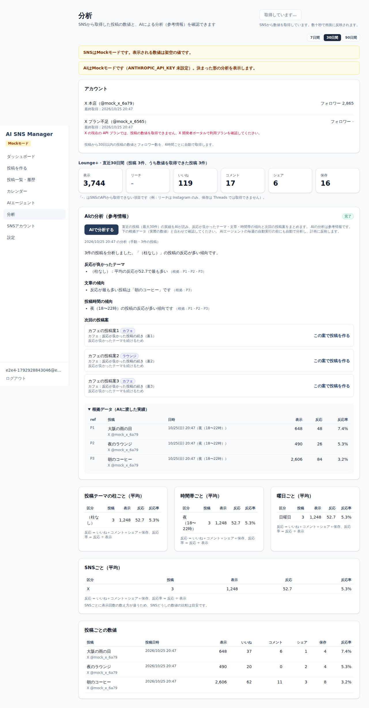
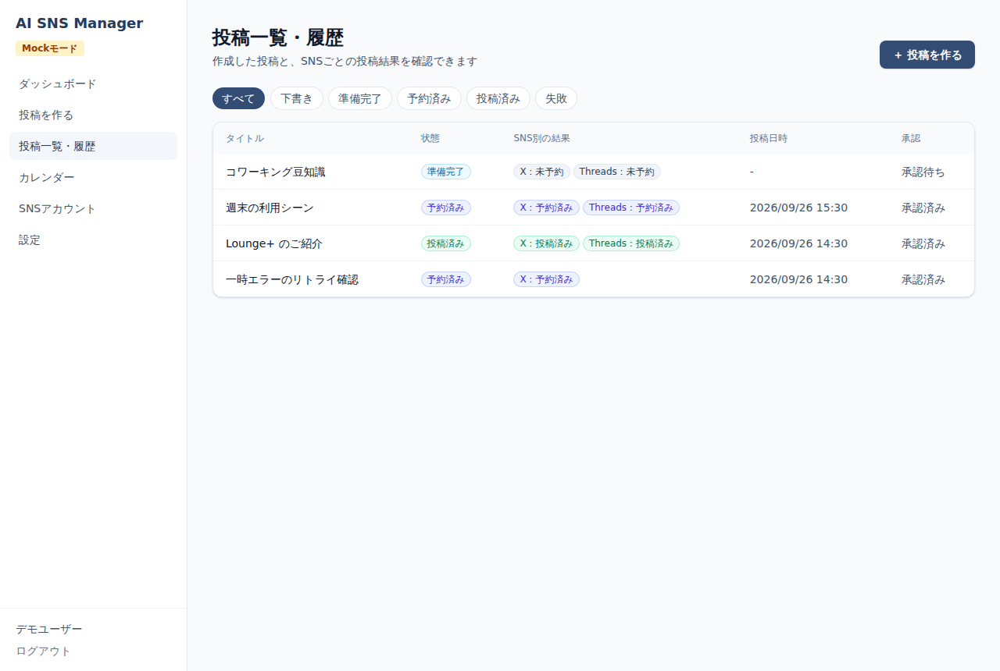
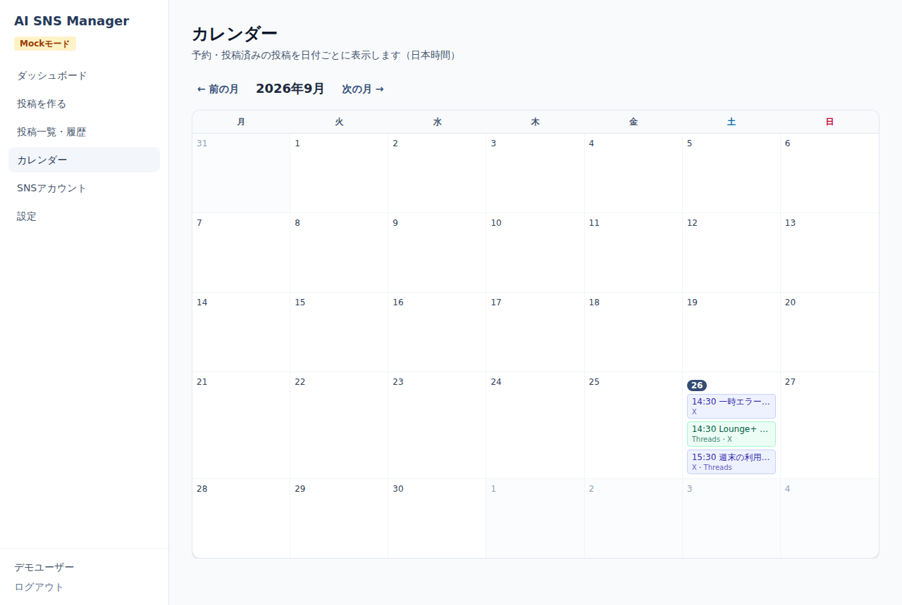
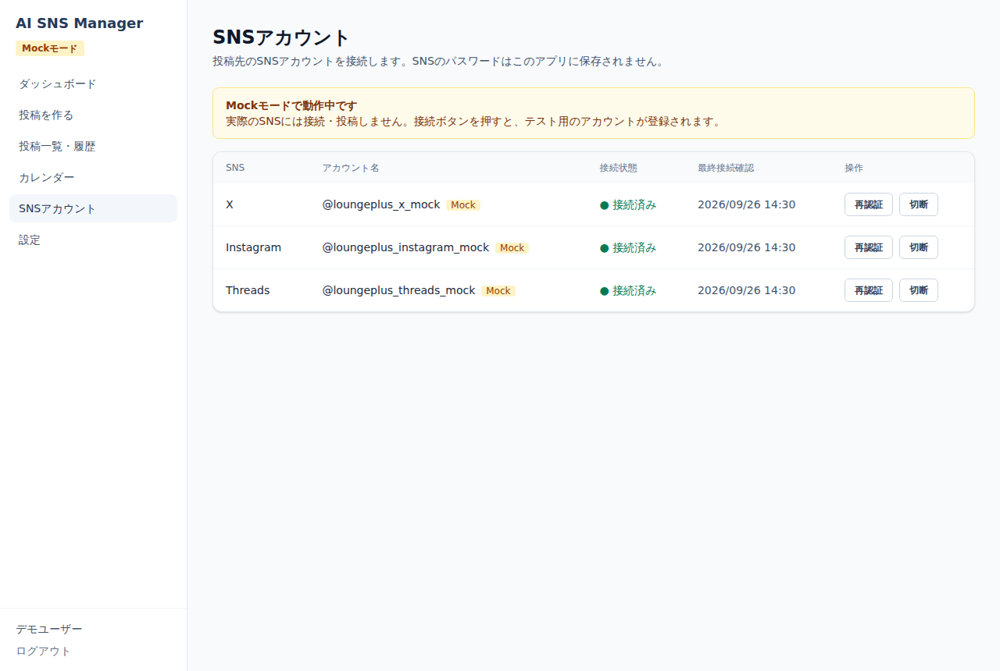
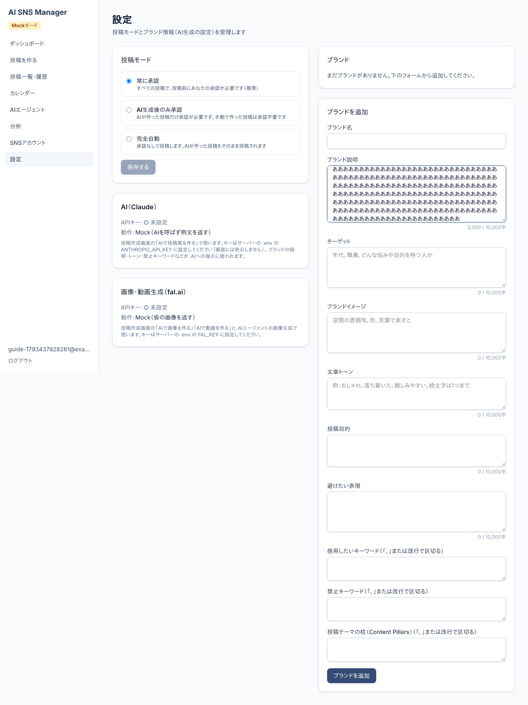
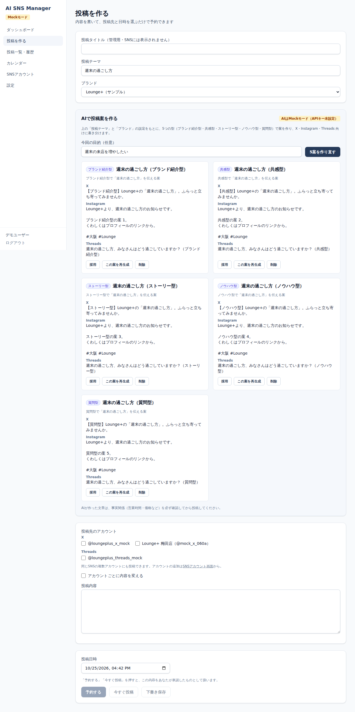
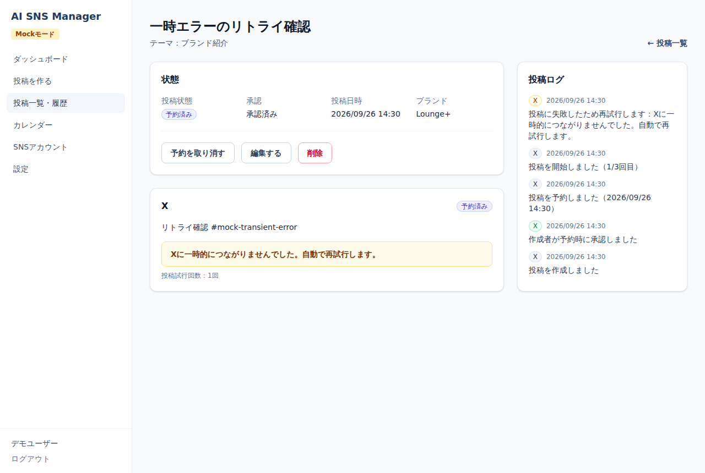

# AI SNS Manager

X・Instagram・Threads への投稿を一元管理する Web アプリです。
最終的には「SNS 運用そのものを AI が支援・自動化するプラットフォーム」を目指します。

> **現在の状態：Phase 4 まで完了。** AI エージェントが今後7日間の投稿テーマ・投稿文・画像・日時をまとめて計画し、承認すると予約します（投稿モード「完全自動」なら承認なしで予約）。
> 投稿の数値（表示・いいね など）を SNS から取得して分析画面に表示し、AI が分析した結果は次の投稿案と AI エージェントの計画に使います。
> 投稿案の生成は Claude、画像・動画の生成は fal.ai を使います。各 SNS の APIキーを登録すると実際に投稿できます（`SOCIAL_PROVIDER_MODE=live`）。
> 初期設定は **Mock モード**（実際の SNS には投稿せず、数値も仮の値）です。実際の SNS から数値を取得する動作は本物のキーで未確認です（→ [ロードマップ](#ロードマップと未実装機能)）。

---

## 概要

| 項目 | 内容 |
| --- | --- |
| Frontend | Next.js 15（App Router）/ React 19 / TypeScript / Tailwind CSS 4 |
| Backend | Next.js Route Handlers / TypeScript |
| DB | PostgreSQL 16 + Prisma 6 |
| 認証 | Auth.js v5（メールアドレス + パスワード。パスワードは bcrypt でハッシュ化） |
| ジョブキュー | Redis + BullMQ（投稿は必ず Worker が非同期で実行） |
| テスト | Vitest（単体・統合）/ Playwright（E2E） |

基本操作は 5 ステップです：**① 投稿を作る → ② AI に案を作らせる → ③ 採用・承認 → ④ 投稿日時を決める → ⑤ 投稿する**

## 機能

- **ログイン / ユーザー登録**（メールアドレス + パスワード）
- **ダッシュボード**：今週の投稿、成功（今週）、予約、下書きの件数、**AI おすすめ投稿**（最新の分析の次回投稿案 3 件。「5案生成」で投稿作成画面を開き、5 案を自動で作る）、接続 SNS、AI エージェント、最近の投稿
- **SNS アカウント管理**：APIキーを入力して連携。**同じ SNS に複数アカウント**を登録可能。キーの確認・更新・切断（SNS のパスワードは不要・保存しない。キーは AES-256-GCM で暗号化保存し、画面には末尾4文字のみ表示）
- **複数アカウントへの投稿**：投稿ごとに投稿先アカウントを選択。アカウントごとに本文を変えることも可能
- **投稿作成・編集**：タイトル、テーマ、ブランド、対象 SNS、SNS ごとの本文、文字数チェック
- **承認**：投稿モード「常に承認（初期値）/ AI 生成後のみ承認 / 完全自動」。承認・却下
- **予約投稿 / 今すぐ投稿**：BullMQ の遅延ジョブで実行。Web リクエスト内では投稿しない
- **自動リトライ**：一時的なエラーは 30 秒後 → 2 分後に再試行（最大 3 回）。認証・権限・内容エラーは再試行しない
- **二重投稿防止**：`postId:platform` を冪等キーにしてジョブ ID と状態遷移で保護
- **カレンダー**：月表示（月曜始まり・日本時間）
- **投稿一覧・履歴**：状態で絞り込み、SNS 別の成功/失敗表示
- **投稿ログ**：作成・承認・予約・投稿開始・成功・失敗・リトライを記録（秘密情報はマスク）
- **ブランド設定**：ブランド名、説明、ターゲット、トーン、キーワード、禁止ワード、投稿テーマの柱など（AI 生成の指示に使用）
- **AI 投稿生成（Claude）**：投稿テーマとブランド情報から、5つの型（ブランド紹介型・共感型・ストーリー型・ノウハウ型・質問型）で投稿案を作成し、X・Instagram・Threads 向けに書き分け。案ごとに「採用・この案を再生成・削除」。採用した文章は自由に編集できる
- **AI の品質チェック**：生成後に文字数（X は日本語を2文字として数える）・禁止ワード・重複・URL・ハッシュタグ数を自動チェックし、問題があった案だけ問題点を伝えて作り直す（最大2回）。予約時にも禁止ワードを確認
- **AI 生成の承認**：AI の案から作った投稿は記録され、投稿モード「AI生成後のみ承認」では承認するまで予約できない
- **画像・動画の生成（fal.ai）**：「窓際でコーヒーを飲む様子」のような日本語のイメージから、Claude が生成用の指示（英語プロンプト、動画は構成メモも）を作り、fal.ai で画像（FLUX）や約10秒の動画（Kling）を生成。生成は Worker で行い、できあがると投稿に添付できる
- **画像・動画付きの投稿**：X（画像・動画）、Instagram（画像・リール）、Threads（画像・動画）。URL を指定して添付することもできる
- **AI エージェント**：ブランドごとに投稿頻度（週◯回）・曜日・時刻・投稿先を設定すると、今後7日間の投稿枠を決め、投稿履歴を見て「投稿テーマの柱」が偏らないようにテーマと型を計画。投稿文と画像を作って「承認待ち」の投稿にし、まとめて承認すると計画した日時で予約。ボタンでの実行と、毎週の自動実行（曜日・時刻を指定）に対応
- **完全自動モード**：投稿モード「完全自動」では、AI エージェントが作った投稿を承認なしで予約する（初期値は「常に承認」）
- **分析**（`/analytics`）：ブランドごと、期間 7 / 30 / 90 日（初期値 30 日）で表示。アカウントのフォロワー数（期間中の増減、最終取得日時）、投稿の合計（表示・リーチ・いいね・コメント・シェア・保存）、投稿テーマの柱・時間帯・曜日・SNS ごとの平均、投稿ごとの一覧。SNS の API が返さない数値は「-」と表示し、0 とは区別します
  - 数値は 6 時間ごとに自動で取得します（直近 30 日に公開した投稿が対象）。「数値を更新」で今すぐ取り直せます。取得できなかった理由はアカウントごとに表示します
  - 「**AIで分析する**」：直近 90 日の投稿（数値のあるもの・最大 30 件）をもとに、反応の良かったテーマ、文章の傾向、時間帯の傾向、次の投稿案 3 件を作ります。結果は根拠の投稿データと並べて「参考情報」として表示し、「この案で投稿を作る」で、テーマを入れた投稿作成画面を開けます
  - 毎週の自動実行の AI エージェントは、計画の直前に分析を行い、その結果を投稿テーマの選びに使います。手動の実行では、14 日以内に完了した最新の分析を参考にします。投稿の日時は引き続きユーザー設定から決めます
- **Mock モード**：SNS・AI・画像生成の API を呼ばずに、キー確認・投稿成功・失敗・生成をシミュレーション

## スクリーンショット

| AI エージェント（計画 → まとめて承認） |
| --- |
|  |

| ダッシュボード | 投稿作成 |
| --- | --- |
|  |  |

| 分析（数値・AI 分析） |
| --- |
|  |

| 投稿一覧・履歴 | カレンダー |
| --- | --- |
|  |  |

| SNS アカウント | 設定 |
| --- | --- |
|  |  |

AI の投稿案（5つの型で作成し、採用・再生成・削除を選ぶ）：



リトライ中の投稿詳細（ユーザーには分かりやすいエラー文、詳細はログへ）：



## セットアップ

必要なもの：Node.js 20 以上、PostgreSQL、Redis（Docker があれば `docker compose` で両方起動できます）。

```bash
git clone <このリポジトリ>
cd ai-sns-manager
npm install

# 環境変数
cp .env.example .env
# AUTH_SECRET と ENCRYPTION_KEY を生成して .env に書く
openssl rand -base64 32   # → AUTH_SECRET
openssl rand -base64 32   # → ENCRYPTION_KEY
```

Windows（PowerShell）で `openssl` が無い場合：

```powershell
[Convert]::ToBase64String((1..32 | ForEach-Object { Get-Random -Maximum 256 }))
```

## 環境変数

| 変数 | 必須 | 説明 |
| --- | --- | --- |
| `DATABASE_URL` | ✅ | PostgreSQL 接続文字列 |
| `REDIS_URL` | ✅ | Redis 接続文字列 |
| `AUTH_SECRET` | ✅ | Auth.js のセッション署名キー |
| `AUTH_URL` | 本番 | 公開 URL |
| `AUTH_TRUST_HOST` | 本番 | リバースプロキシ配下なら `true` |
| `ENCRYPTION_KEY` | ✅ | SNS の APIキーを暗号化するキー（32 バイトの base64） |
| `SOCIAL_PROVIDER_MODE` | | `mock`（初期値・実際には投稿しない）/ `live`（登録した APIキーで実際に投稿） |
| `MOCK_TRANSIENT_FAILURE_RATE` | | Mock で一時失敗させる割合（0〜1）。リトライ確認用 |
| `ANTHROPIC_API_KEY` | | Claude の APIキー。AI 投稿生成で使用。設定状況は「設定」画面で確認できる |
| `ALLOWED_EMAILS` | 公開時 | 新規登録できるメールアドレス（カンマ区切り）。公開URLで動かすときは必ず設定する |
| `ANTHROPIC_MODEL` | | 使用するモデル（空なら `claude-sonnet-5-5`） |
| `ANTHROPIC_EFFORT` | | 考える深さ `low` / `medium` / `high`（空なら `medium`） |
| `AI_PROVIDER_MODE` | | `claude` / `mock`。空なら APIキーがあれば Claude、なければ Mock（決まった例文を返す） |
| `THREADS_API_VERSION` / `INSTAGRAM_API_VERSION` | | Meta Graph API のバージョン指定（任意。空ならアプリの既定） |
| `FAL_KEY` | | fal.ai の APIキー。画像・動画生成で使用。未設定なら Mock（仮の画像） |
| `FAL_IMAGE_MODEL` / `FAL_VIDEO_MODEL` | | 使う fal.ai のモデル（空なら `fal-ai/flux-1/schnell` / `fal-ai/kling-video/v2.5-turbo/pro/text-to-video`） |
| `MEDIA_PROVIDER_MODE` | | `fal` / `mock`。空なら FAL_KEY があれば fal、なければ Mock |
| `TEST_DATABASE_URL` | | 設定すると DB を使う統合テストが実行される |

`.env` は Git 管理対象外です。API キーをソースコードに書かないでください。

## DB 構築

```bash
docker compose up -d        # PostgreSQL と Redis を起動（Docker を使う場合）
npm run db:migrate          # マイグレーション適用 + Prisma Client 生成
npm run db:seed             # 開発用サンプル（demo@example.com / demo-password、ブランド「Lounge+」）
```

サンプルデータは `isSample` フラグ付きで作成され、本番環境（`NODE_ENV=production`）では投入されません。
テーブル設計は [docs/database.md](docs/database.md) を参照してください。

## Redis

予約投稿・画像/動画の生成・AI エージェント・分析は BullMQ（Redis）のジョブで実行します。**Web サーバーとは別に Worker プロセスが必要です。**

```bash
npm run worker            # 投稿・画像/動画生成・AI エージェント・分析の Worker をまとめて起動（4 つ）
# 役割ごとに分けて起動する場合
npm run worker:post       # 予約投稿
npm run worker:media      # 画像・動画生成
npm run worker:ai         # AI エージェント（毎週の自動実行を含む）
npm run worker:analytics  # 分析（数値の取得・AI 分析）
```

Worker は起動時に「DB では予約中なのにキューにジョブが無い」投稿を再登録し、AI エージェントの毎週の自動実行も設定に合わせて登録し直します（Redis のデータ消失対策）。分析の Worker は起動時に、6 時間ごとの数値取得を登録し直します。

## SNS API 設定

SNS のキーは `.env` ではなく、アプリの **「SNSアカウント」画面**からアカウントごとに登録します。

> **キーの取り方が分からないときは：** 「SNSアカウント」画面の各 SNS にある「はじめての方へ：◯◯のキーの取得方法」を開くと、実際の画面（またはイメージ図）つきの手順が読めます。同じ内容を [docs/sns-setup-guide.md](docs/sns-setup-guide.md) にも載せています。

「連携する」を押すと、入力したキーで SNS に問い合わせてアカウント名を取得し、確認できたものだけを暗号化して保存します。
同じ SNS に複数のアカウントを登録でき、投稿作成画面で投稿先のアカウントを選べます。

| SNS | 入力するキー | 取得場所・条件 |
| --- | --- | --- |
| X | API Key / API Key Secret / Access Token / Access Token Secret | X 開発者ポータルのアプリの「Keys and tokens」。アプリの権限を **Read and Write** にしてから Access Token を発行する。投稿 API の利用には X API の有料プランが必要な場合がある（最新の料金・上限は開発者ポータルで確認） |
| Threads | アクセストークン（長期） | Meta for Developers で Threads のユースケースを持つアプリを作成し、`threads_basic`・`threads_content_publish` の権限でトークンを発行。分析の数値を取得するには `threads_manage_insights` も必要 |
| Instagram | アクセストークン（長期） | プロアカウント（ビジネス／クリエイター）のみ。「Instagram ログインを使った Instagram API」でアプリを作成し、`instagram_business_basic`・`instagram_business_content_publish` の権限でトークンを発行。分析の数値を取得するには `instagram_business_manage_insights` も必要 |

- Threads・Instagram の長期アクセストークンには有効期限があります。期限が切れると投稿が「接続が切れています」で失敗し、アカウントが「再認証が必要」になります。新しいトークンを発行して「キーを更新」で入れ直してください
- Instagram は画像・動画なしでは投稿できません。投稿作成画面で「AIで画像を作る」「AIで動画を作る」か、**https:// の公開URL** を指定してください（パソコンからのファイルのアップロードには未対応）
- 実際に投稿するには `.env` の `SOCIAL_PROVIDER_MODE=live` にして、Web と Worker を再起動します。Mock モードで登録したアカウントは live では使えないため、live で登録し直してください

各 SNS の API の呼び出し方と確認元は [docs/social-api.md](docs/social-api.md) を参照してください。

### Mock モード（開発・テスト用）

- キーには任意の文字列を入力できます（`invalid` を含めると「無効なキー」として扱われます）。同じキーは同じアカウント、違うキーは別アカウントになります
- 投稿本文に次のタグを入れると失敗を再現できます
  - `#mock-auth-error`：接続切れ（再試行せず失敗、アカウントは「再認証が必要」に）
  - `#mock-content-error`：投稿内容エラー（再試行せず失敗）
  - `#mock-transient-error`：一時的な障害（30 秒 → 2 分と再試行し、3 回目で失敗）

## AI API 設定

投稿案の生成には Claude（Anthropic）を使います。

1. [Claude Console](https://platform.claude.com/) で APIキーを発行する
2. `.env` の `ANTHROPIC_API_KEY` に設定し、アプリを再起動する（「設定」画面で「設定済み」「Claude（claude-sonnet-5-5）」と表示されれば OK）
3. 投稿作成画面で「投稿テーマ」と「ブランド」を選び、「AIで投稿案を作る」の「5案を生成」を押す

- 既定のモデルは `claude-sonnet-5-5`（品質と料金のバランス型）。`ANTHROPIC_MODEL` で変更できます
- 5案の生成は1回の呼び出しでまとめて行い、30秒ほどかかります。問題があった案の作り直しには追加の呼び出しが発生します（料金は Claude の利用量に応じて発生）
- 安全上の理由でモデルが回答を断った場合に、別のモデルで自動的にやり直す機能（サーバー側フォールバック）を有効にしています
- APIキーが未設定の場合は Mock（決まった例文を返す）で動き、画面に「AIはMockモード」と表示されます
- AI が作った文章は事実関係（営業時間・価格など）を必ず確認してから投稿してください。指示では、確認できない事実や URL を書かないようにしています
- プロンプトは `prompts/`（共通の指示と、X・Instagram・Threads ごとの書き方）に分けて管理しています。文章の雰囲気を変えたいときはここを編集します

## 開発方法

```bash
npm run dev      # http://localhost:3000
npm run worker   # 別ターミナルで Worker を起動
```

| コマンド | 内容 |
| --- | --- |
| `npm run dev` | 開発サーバー |
| `npm run worker` | 投稿 Worker |
| `npm run lint` | ESLint |
| `npm run typecheck` | 型チェック |
| `npm test` | 単体・統合テスト（Vitest） |
| `npm run test:e2e` | E2E テスト（Playwright） |
| `npm run build` | 本番ビルド |
| `npm run db:studio` | Prisma Studio で DB を確認 |

設計の詳細：[アーキテクチャ](docs/architecture.md) / [API](docs/api.md) / [DB](docs/database.md)。
開発ルールは [CLAUDE.md](CLAUDE.md) にまとめています。

## テスト

```bash
npm test
```

- **単体テスト**：キー暗号化、各 SNS の Adapter（X の OAuth 署名・Threads・Instagram の呼び出し手順を偽のサーバーで確認）、Mock SNS Adapter、投稿バリデーション、予約日時・カレンダー計算、リトライ間隔、状態集計、ログのマスク、分析（集計・AI 分析の根拠の確認）
- **統合テスト**（`TEST_DATABASE_URL` / `REDIS_URL` が設定されているとき）：投稿作成 → 承認 → 予約 → 投稿、二重投稿防止、リトライ、失敗時の状態、他ユーザーからのアクセス拒否、キュー登録・取消
- **E2E**：`npm run build` 後に `npm run test:e2e`。アプリと Worker を起動し、登録 → ログイン → APIキーで複数アカウント連携 → 投稿作成 → 承認 → 今すぐ投稿 → 予約 → カレンダー → 失敗表示までを確認します
  - 分析画面の表示も E2E（`tests/e2e/phase4.spec.ts`）で確認します
  - Playwright のブラウザ：`npx playwright install chromium`（インストール済みのものを使う場合は `PLAYWRIGHT_CHROMIUM_EXECUTABLE` にパスを指定）

テスト用 DB は開発用と分けてください（例：`ai_sns_manager_test` を作成し `DATABASE_URL=<テスト用> npx prisma migrate deploy`）。

## デプロイ

Web サーバー・Worker・PostgreSQL・Redis の 4 つが必要です。Render や Railway なら
「Web Service + Background Worker + PostgreSQL + Redis」の構成で動かせます。
Vercel だけでは常駐 Worker を動かせないため、Worker は別ホストが必要です。
手順は [docs/deployment.md](docs/deployment.md)。

```bash
npm run build && npm run db:deploy
npm run start     # Web
npm run worker    # Worker（別プロセス）
```

## トラブルシューティング

| 症状 | 対処 |
| --- | --- |
| 予約した投稿がいつまでも「予約済み」のまま | Worker（`npm run worker`）が起動しているか確認してください |
| 「予約処理を開始できませんでした」 | Redis に接続できていません。`REDIS_URL` と Redis の起動を確認してください |
| 「◯◯のキーを確認できませんでした」 | キーの値（前後の空白・コピー漏れ）と、投稿の権限（X は Read and Write、Threads/Instagram は content_publish）を確認してください |
| 「◯◯ は再接続が必要です」 | トークンの期限切れなどです。SNSアカウント画面で新しいキーを「キーを更新」から入れ直すか、「接続確認」を押してください。モードを切り替えた場合も登録し直しが必要です（Mock と live のアカウントは混在できません） |
| `ENCRYPTION_KEY は32バイト…` | `openssl rand -base64 32` で生成した値を設定してください。**運用開始後に変更すると保存済みの APIキーが復号できなくなります**（キーの再登録が必要） |
| ログインできない | `AUTH_SECRET` が設定されているか、本番では `AUTH_URL` / `AUTH_TRUST_HOST` を確認してください |
| Prisma のエラー | `npm run db:migrate` を実行し、`DATABASE_URL` を確認してください |

## ロードマップと未実装機能

| Phase | 内容 | 状態 |
| --- | --- | --- |
| 1 | ログイン、Dashboard、ブランド、SNS アカウント（APIキー連携・複数アカウント・実投稿）、投稿作成・編集・承認・予約、キュー・リトライ、カレンダー、履歴、ログ | ✅ 完了 |
| 2 | AI 投稿生成（5 案）、SNS 別最適化、Brand Voice、禁止ワードチェック、承認、再生成 | ✅ 完了 |
| 3 | 画像・動画生成（fal.ai）、AI スケジュール、AI Agent、完全自動モード | ✅ 完了 |
| 4 | 分析（投稿の数値・フォロワー数の取得、分析画面）、AI 分析、分析結果の AI エージェントへの反映 | ✅ 完了 |

まだ実装していないもの・確認できていないもの（理由）：

- **本物の SNS での動作確認**：開発環境から各 SNS の API に接続できず、実際のキーでの投稿は未確認です。リクエスト形式は公式 SDK・公式サンプル・公式ドキュメントに合わせ、偽のサーバーを使ったテストで確認しています。最初の本番利用時は、テスト用アカウントで1件投稿して確認してください
- **本物の SNS での数値取得**：実際のキーがないため、分析の数値取得は未確認です。Threads は `threads_manage_insights`、Instagram は `instagram_business_manage_insights` の権限がないと数値を取得できません。Mock の数値は仮の値です
- **クリック数**：投稿ごとのクリック数を返す API が確認できないため、どの SNS からも取得していません。DB の列はありますが常に空で、画面にも表示しません
- **本物の Claude・fal.ai での生成**：開発環境に APIキーがなく未確認です。呼び出し方は公式 SDK・公式クライアントの型定義に合わせ、偽の応答を使ったテストで確認しています
- **パソコンからの画像・動画のアップロード**：保存先（ストレージ）が必要なため未対応。AI 生成か URL 指定で添付します
- **生成した画像・動画の保存期間**：fal.ai の公開URLをそのまま使っています。fal.ai 側の保存期間（一定期間後に消える可能性）は公式の規約で確認してください。長期保存が必要なら自前のストレージ（R2・S3 など）への保存を追加します
- **動画の長さ**：指示書は15秒ですが、使用している動画モデルの上限が10秒のため10秒で作ります
- **カレンダーのドラッグ＆ドロップ**：Phase 1 は日時指定で予約する方針のため
- **Threads / Instagram のトークン自動更新**：期限切れ時は「キーを更新」で入れ直す運用。自動更新は今後の対応
- **パスワードリセット・メール認証**：メール送信基盤が未導入のため
