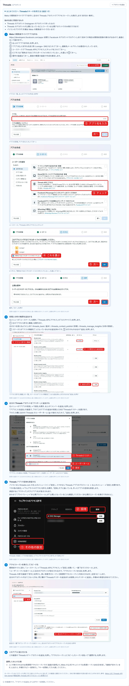
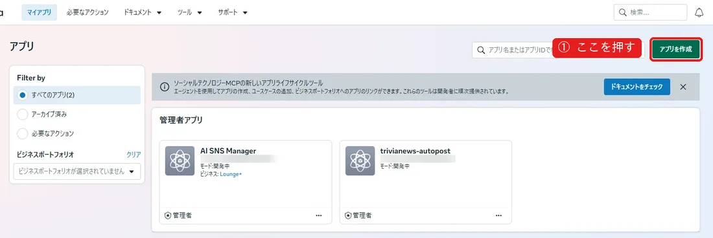
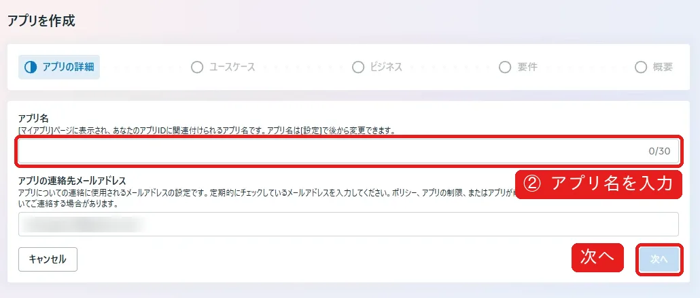
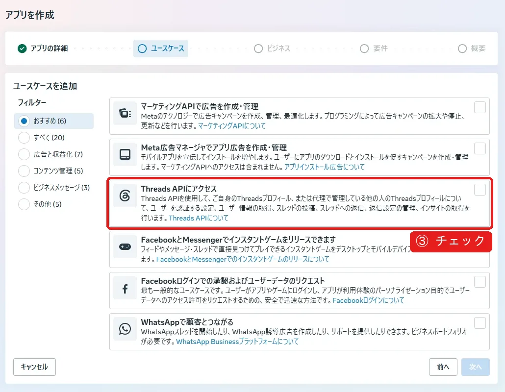
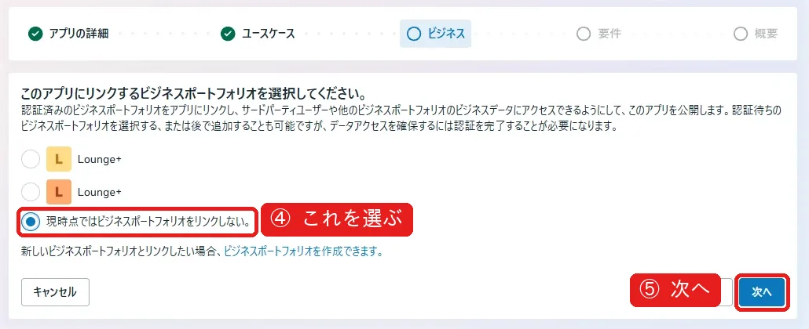
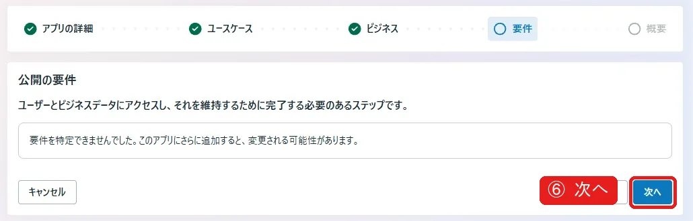
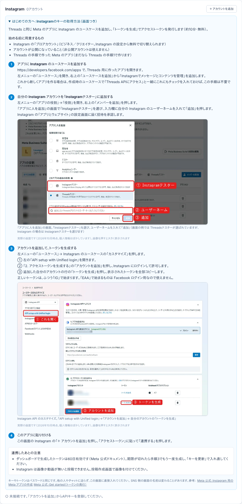
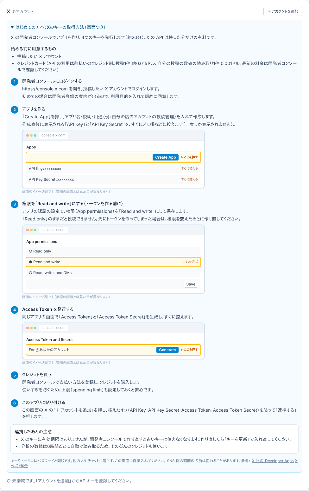

# SNS のキーの取得方法

アプリの「SNSアカウント」画面の「はじめての方へ」と同じ内容です。実際の画面のスクリーンショット（個人情報はぼかし済み）がある手順は、その画像を載せています。
手順は各 SNS の公式ドキュメントで確認した内容です（2026-10-31 時点）。SNS 側の画面の名前は変わることがあります。
このファイルは `lib/social/setup-guides.ts` から作っています。手順を直すときはそちらを直してください。

## Threads

Meta の開発者サイトでアプリを作り、自分の Threads アカウントで「アクセストークン」を発行します（約15分・無料）。

**始める前に用意するもの**

- Threads のアカウント（Instagram のアカウントで作ったもの）
- Threads のアカウントが公開になっていること（トークンは公開アカウントでのみ発行できます）
- パソコンのブラウザ（作業は Meta の開発者サイトで行います）

### 1. Meta の開発者サイトでアプリを作る

- https://developers.facebook.com/apps を開き、Facebook のアカウントでログインします（初めての場合は開発者登録の案内が出るので、画面に沿って進めます）。
- ① 右上の「アプリを作成」を押します。
- ② 「アプリ名」に好きな名前（例：Lounge+ SNS）を入れて「次へ」。連絡先メールアドレスは最初から入っています。
- ③ ユースケースで「Threads APIにアクセス」にチェックを入れて「次へ」。
- ④ ビジネスは「現時点ではビジネスポートフォリオをリンクしない。」を選んで⑤「次へ」。
- ⑥ 要件の画面は「次へ」。最後の概要の画面で作成を確定します。

### 2. 投稿と分析の権限を追加する

- 左メニューの「ユースケース」を開き、「Threads APIにアクセス」の「カスタマイズ」を押します。
- 「権限」の一覧で、次の3つの「追加」を押します：threads_basic（基本）、threads_content_publish（投稿）、threads_manage_insights（分析の数値）。

### 3. 自分の Threads アカウントを「テスター」に追加する

- 左メニューの「アプリの役割」→「役割」を開き、右上の「メンバーを追加」を押します。
- 「アプリに人を追加」の画面で、下の「このアプリの追加の役割」にある「Threadsテスター」を選びます。
- 下の入力欄に自分の Threads のユーザーネーム（@ の後ろ）を入れて、「追加」を押します。

### 4. Threads アプリで招待を承認する

- パソコンなら threads.com の左上のメニュー（＝）→「設定」、スマホなら Threads アプリのプロフィール → 右上のメニュー →「設定」を開きます。
- 「その他の設定」→「ウェブサイトのアクセス許可」を開き、「招待」タブに届いている、作ったアプリの招待を承認します。
- 承認すると「アクティブ」タブにアプリ名が表示されます。
- あわせて「プライバシー」→「非公開プロフィール」が「公開」になっていることも確認してください（非公開だとトークンを発行できません）。

### 5. アクセストークンを発行してコピーする

- 開発者サイトに戻り、「ユースケース」→「Threads APIにアクセス」→「設定」を開いて、一番下までスクロールします。
- 「ユーザートークン生成ツール」に自分のアカウントが表示されるので、「アクセストークンを生成」を押します。
- Threads の許可画面で「許可」を押すと、長い英数字のトークン（長期間アクセストークン）が表示されます。全部コピーします。
- 自分のアカウントが出てこないときは、同じ欄の「Threadsテスターを追加または削除」からテスターに追加し、手順4の承認を済ませてください。

### 6. このアプリに貼り付ける

- この画面の Threads の「＋ アカウントを追加」を押し、「アクセストークン」にコピーしたトークンを貼って「連携する」を押します。

**連携したあとの注意**

- ここで発行されるのは長期間アクセストークンです（画面の説明より。Meta の公式ドキュメントでは長期トークンは60日有効）。「接続が切れています」と出たら、手順5でもう一度発行し、「キーを更新」で入れ直してください。

参考：[Meta 公式：Threads API Get started](https://developers.facebook.com/docs/threads/get-started) / [解説記事：Threads API アクセストークン取得ガイド](https://note.com/kazu_t/n/n6d1df495dde8)

## Instagram

Meta の開発者サイトでアプリを作り、Instagram の「Generate token」でアクセストークンを発行します（約10分・無料）。

**始める前に用意するもの**

- Instagram の「プロアカウント」（ビジネス／クリエイター。Instagram の設定から無料で切り替えられます）
- アカウントが公開になっていること（非公開アカウントは使えません）
- Threads 用とは別のアプリを作ります

### 1. Meta の開発者サイトでアプリを作る

- https://developers.facebook.com/apps を開き、右上の「アプリを作成」を押します。
- ビジネスの接続は今はスキップして「次へ」。
- ユースケースは「その他」、アプリの種類は「ビジネス」を選びます（「ビジネス」でないと Instagram を追加できません）。
- アプリ名と連絡先メールを入れて作成します。

### 2. Instagram を追加する

- アプリの画面に並んでいる製品の中から「Instagram」を探し、「設定」を押します。

### 3. 自分の Instagram アカウントを追加する

- 左メニューの「Instagram」→「API setup with Instagram business login」を開きます。
- 「アクセストークンを生成」（Generate access tokens）の欄で「アカウントを追加」を押し、Instagram にログインして許可します。

### 4. トークンを発行してコピーする

- 追加したアカウントの横の「Generate token」を押し、表示されたトークンを全部コピーします。
- 正しいトークンは、ふつう「IG」で始まります。「EAA」で始まるものは Facebook ログイン用なので使えません。

### 5. このアプリに貼り付ける

- この画面の Instagram の「＋ アカウントを追加」を押し、「アクセストークン」に貼って「連携する」を押します。

**連携したあとの注意**

- このトークンは60日有効です（Meta 公式ドキュメント）。期限が切れたら手順4でもう一度発行し、「キーを更新」で入れ直してください。
- Instagram は画像か動画が無いと投稿できません。投稿作成画面で画像を付けてください。

参考：[Meta 公式：Instagram 用の Meta アプリの作成](https://developers.facebook.com/docs/instagram-platform/instagram-api-with-instagram-login/create-a-meta-app-with-instagram) / [Meta 公式：Get started（トークンの発行）](https://developers.facebook.com/docs/instagram-platform/instagram-api-with-instagram-login/get-started)

## X

X の開発者コンソールでアプリを作り、4つのキーを発行します（約20分）。X の API は使った分だけの有料です。

**始める前に用意するもの**

- 投稿したい X アカウント
- クレジットカード（API の利用は前払いのクレジット制。投稿1件 約0.015ドル、自分の投稿の数値の読み取り1件 0.001ドル。最新の料金は開発者コンソールで確認してください）

### 1. 開発者コンソールにログインする

- https://console.x.com を開き、投稿したい X アカウントでログインします。
- 初めての場合は開発者登録の案内が出るので、利用目的を入れて規約に同意します。

### 2. アプリを作る

- 「Create App」を押し、アプリ名・説明・用途（例：自分の店のアカウントの投稿管理）を入れて作成します。
- 作成直後に表示される「API Key」と「API Key Secret」を、すぐにメモ帳などに控えます（一度しか表示されません）。

### 3. 権限を「Read and write」にする（トークンを作る前に）

- アプリの認証の設定で、権限（App permissions）を「Read and write」にして保存します。
- 「Read only」のままだと投稿できません。先にトークンを作ってしまった場合は、権限を変えたあとに作り直してください。

### 4. Access Token を発行する

- 同じアプリの画面で「Access Token」と「Access Token Secret」を生成し、すぐに控えます。

### 5. クレジットを買う

- 開発者コンソールで支払い方法を登録し、クレジットを購入します。
- 使いすぎを防ぐため、上限（spending limit）も設定しておくと安心です。

### 6. このアプリに貼り付ける

- この画面の X の「＋ アカウントを追加」を押し、控えた4つ（API Key・API Key Secret・Access Token・Access Token Secret）を貼って「連携する」を押します。

**連携したあとの注意**

- X のキーに有効期限はありませんが、開発者コンソールで作り直すと古いキーは使えなくなります。作り直したら「キーを更新」で入れ直してください。
- 分析の数値は6時間ごとに自動で読み取るため、そのぶんのクレジットも使います。

参考：[X 公式：Developer Apps](https://docs.x.com/fundamentals/developer-apps) / [X 公式：料金](https://docs.x.com/x-api/getting-started/pricing)
